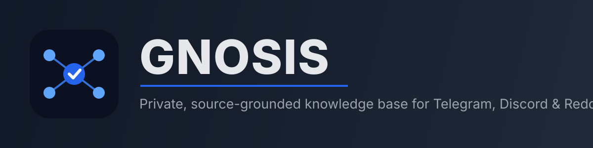

<p align="center">
  
</p>

<p align="center">
  
</p>

<p align="center">
  <a href="https://github.com/PrimeBuild-pc/Gnosis/commits/main"></a>
  <a href="https://github.com/PrimeBuild-pc/Gnosis/stargazers"></a>
  <a href="https://github.com/PrimeBuild-pc/Gnosis/issues"></a>
</p>

<p align="center">
  <a href="https://github.com/PrimeBuild-pc/Gnosis/actions/workflows/ci.yml"></a>
  <a href="LICENSE"></a>
  
  
</p>

<p align="center">
  
  
  
  
</p>

<p align="center"><i>Raccogli contenuti autorizzati, cerca nelle fonti e ottieni risposte con citazioni ai messaggi originali.</i></p>

---

# Gnosis

Knowledge base privata per contenuti autorizzati di Discord, Telegram e Reddit: raccolta,
ricerca ibrida PostgreSQL/pgvector, risposte con citazioni, digest e dashboard IT/EN.
Python 3.11+, FastAPI, vanilla JavaScript, Docker Compose. Progetto in sviluppo, licenza MIT.

## Prima di iniziare: limiti e costi

- **Un solo operatore fidato**, con un account admin HTTP Basic. Dashboard e API amministrano
  l'intera installazione: il selettore workspace è un filtro, **non** un confine di autorizzazione
  tra utenti web. Non è un SaaS pubblico multi-tenant. Per amministratori che non devono vedere
  i dati reciproci, usa installazioni, database, credenziali e volumi separati.
- Lo stesso bot Discord può servire più server. I comandi richiedono un workspace associato
  esplicitamente all'ID del server e ai suoi ruoli; senza mapping o con ruoli vuoti negano
  l'accesso. `/ask` usa solo messaggi del server, workspace e canali che il membro può leggere.
  Le risposte sono private (ephemeral), senza menzioni automatiche. `/digest` verifica tutti
  i messaggi di input salvati contro i permessi attuali, non soltanto le citazioni; i digest
  precedenti alla migration 006 non sono mostrati da Discord finché non vengono rigenerati.
- La dashboard, il grafo e il bot Telegram autorizzato possono consultare **tutte** le fonti.
  Telegram risponde solo in conversazioni private: autorizza soltanto operatori fidati.
- Self-hosting non significa offline: Discord/Telegram/Reddit richiedono rete e API. Se usi
  chat o embedding remoti, i contenuti elaborati vengono inviati al provider. Gli embedding
  predefiniti sono locali; il build scarica il modello da terzi e richiede rete, spazio e RAM.
- **ChatGPT/Codex/Claude/Pi e gli abbonamenti coding agent non sono credito OpenAI API.**
  Per un provider remoto servono credenziali API e la relativa fatturazione. I free tier possono
  cambiare, avere quote o non offrire il modello scelto. È possibile usare un modello chat
  locale compatibile OpenAI già disponibile: non serve comprare una chiave OpenAI.
- Citazioni valide non garantiscono che il modello abbia interpretato correttamente la fonte.
  Controlla gli originali prima di prendere decisioni. Non raccogliere contenuti senza consenso.

## Installazione homelab consigliata (Linux + Docker)

### 1. Prepara la macchina

Installa Git, [Docker Engine](https://docs.docker.com/engine/install/) e il plugin
[Docker Compose](https://docs.docker.com/compose/install/) **>= 2.30** (versione moderna consigliata).
Su Windows/macOS usa Docker Desktop e una shell Linux/WSL per i comandi qui sotto.
Non è necessario un dominio né aprire porte sul router.

```bash
docker version
docker compose version
git clone https://github.com/PrimeBuild-pc/Gnosis.git
cd Gnosis
```

Prevedi alcuni GB liberi e RAM per PostgreSQL e il modello embedding; i requisiti del modello
chat locale sono separati. Non viene garantito che un determinato tier cloud sia gratuito o
sufficiente. L'app usa CPU per gli embedding e non richiede una GPU per il modello predefinito.

Il gruppo Docker equivale praticamente a root: aggiungici soltanto utenti fidati. L'installer
non installa Docker, non cambia gruppi host e non esegue script scaricati dalla rete.

### 2. Scegli installazione guidata o manuale

**Guidata**, dopo aver letto `install.sh`:

```bash
./install.sh
```

Chiede credenziali admin e configurazione chat, genera una password database per installazioni
nuove, crea un'allowlist vuota e compila il checkout locale. Può chiedere `sudo` esclusivamente
per assegnare il gruppo dei file al container. Non attiva piattaforme né scarica modelli chat.
Il build scarica dipendenze e il modello embedding. Conserva le credenziali non modificate;
non usarlo per ruotare automaticamente la password di un database già esistente.

**Manuale**, passi equivalenti:

```bash
umask 077
cp .env.example .env
printf '# Add only authorized sources.\n' > config/sources.toml
```

Apri `.env` con un editor locale. Imposta:

```dotenv
POSTGRES_PASSWORD=YOUR_RANDOM_ALPHANUMERIC_DATABASE_PASSWORD
DATABASE_URL=postgresql://gnosis:YOUR_RANDOM_ALPHANUMERIC_DATABASE_PASSWORD@db:5432/gnosis
GNOSIS_USERNAME=admin
GNOSIS_PASSWORD=YOUR_UNIQUE_LONG_ADMIN_PASSWORD
```

Genera le password nel tuo password manager. Ripeti la stessa password database nei due
campi; usa caratteri alfanumerici per evitare l'URL encoding. **Non condividere né incollare
il file in una chat con un agente.** `.env` è escluso da Git e usa la sintassi dotenv di
Compose. Per l'editing manuale preferisci credenziali alfanumeriche; i caratteri speciali
richiedono quoting ed escaping corretti (`$` letterale diventa `$$` dentro doppi apici).
Installer e dashboard serializzano automaticamente anche virgolette e backslash.
Valori multilinea non sono supportati. `change-me` o una password admin vuota impediscono l'avvio.

Configura chat in uno dei due modi:

```dotenv
# API OpenAI (fatturazione separata)
OPENAI_API_KEY=YOUR_API_KEY
OPENAI_CHAT_MODEL=gpt-4o-mini
```

oppure:

```dotenv
# Endpoint OpenAI-compatible remoto o un tuo server locale già pronto
GNOSIS_CHAT_API_KEY=local
GNOSIS_CHAT_BASE_URL=http://YOUR_MODEL_SERVICE:11434/v1
OPENAI_CHAT_MODEL=YOUR_INSTALLED_MODEL_NAME
```

`local` è solo un valore non vuoto per server che non richiedono una chiave: non bypassa
l'autenticazione di un provider remoto. Dal container, `127.0.0.1` è il container stesso:
usa il nome di un servizio sulla medesima rete Docker privata. Docker Desktop supporta
`host.docker.internal`; su Linux il mapping `host-gateway` e la raggiungibilità del server
modelli vanno configurati esplicitamente. Non esporre un server modelli senza autenticazione
su Internet per risolvere questo problema. I modelli vanno installati dall'operatore, non
scaricati automaticamente dall'agente.

Puoi lasciare chat non configurata per aprire la dashboard; il worker attende una chiave non
vuota e segnalerà errore finché manca. Lascia locali gli embedding (`local`, dimensioni `384`).
Cambiare provider/modello/dimensioni su dati esistenti richiede una migration e re-indicizzazione:
`db-init` non riapplica migration già eseguite.

### 3. Proteggi i file e avvia

Il container usa UID/GID **10001**, non root. Su un host Linux dedicato, verifica che il gruppo
10001 non contenga altri utenti host; condividi la scrittura soltanto con questo gruppo:

```bash
sudo chgrp 10001 .env config config/sources.toml
chmod 660 .env config/sources.toml
chmod 2770 config
docker compose config --quiet
docker compose build
docker compose run --rm web gnosis db-init
docker compose up -d
```

Mantieni il proprietario host dei file: questi permessi consentono l'editor dell'operatore e
la dashboard, senza `chmod 666`/`777`. Su Desktop i bind mount hanno semantiche diverse: verifica
la scrittura da dashboard e non allargare i permessi a tutti come workaround.

Il build locale serve a eseguire le modifiche del checkout: `pull` del tag registry `latest`
potrebbe scaricare una versione precedente. Il modello embedding viene incluso nell'immagine;
non abbiamo eseguito download/deploy per verificare questa guida.

### 4. Apri e verifica

```bash
docker compose ps
curl --fail http://127.0.0.1:8080/health
```

Apri <http://127.0.0.1:8080>, accedi con le credenziali admin. `/health` è pubblico e indica
solo che il web risponde, non che Discord/chat siano pronti. La pagina **Stato** mostra worker,
pipeline e attività delle sorgenti. API, asset e documentazione `/docs` richiedono autenticazione.

Se la macchina è remota, dal tuo computer:

```bash
ssh -N -L 8080:127.0.0.1:8080 USER@HOMELAB_HOST
```

Apri lo stesso URL locale. Compose pubblica solo loopback; PostgreSQL non pubblica porte host.
HTTP Basic non cifra il traffico: per accesso fuori dal tunnel usa HTTPS con proxy e firewall.
Non pubblicare direttamente 8080. Il proxy deve preservare Host e schema corretti per i
controlli same-origin; limita gli header forwarded a proxy fidati. Non c'è protezione brute-force
integrata: non trattare questa dashboard come un servizio pubblico.

## Discord: configurazione passo per passo, anche su più server

1. Ottieni il consenso degli amministratori dei server e dei titolari dei contenuti.
2. Apri <https://discord.com/developers/applications>, **New Application**, poi **Bot**.
   Copia/resetta il bot token e inseriscilo nel campo `DISCORD_BOT_TOKEN` della pagina Discord
   della dashboard (o in `.env`). È una credenziale: nessun token utente/self-bot è supportato.
3. In **Bot → Privileged Gateway Intents**, abilita **Message Content Intent**. Per questa
   implementazione non sono richiesti Presence o Server Members Intent. Se Discord richiede
   approvazione dell'intent per il tuo bot, completa quella procedura prima di avviarlo.
4. In **OAuth2 → URL Generator**, seleziona `bot` e `applications.commands`. Permessi minimi
   nei canali autorizzati: **View Channels**, **Read Message History**, **Send Messages**
   per le risposte. Non concedere **Administrator**, gestione server/ruoli o espulsione utenti.
   Apri il link, scegli il server e approva. Ripeti per ogni server autorizzato.
5. Dopo aver salvato credenziali ricrea i processi (un semplice `restart` non rilegge `.env`):

   ```bash
   docker compose up -d --force-recreate web worker
   ```

6. Attiva Discord **Impostazioni utente → Avanzate → Modalità sviluppatore**. Copia l'ID del
   **server** e gli ID dei **ruoli** autorizzati (non ID utente o nome ruolo).
7. Nella dashboard **Impostazioni → Workspace**, crea un workspace dal nome univoco con ID
   server. Selezionalo in alto; nella pagina **Discord** salva gli ID ruolo separati da virgola.
   Un workspace senza ruoli nega tutti i comandi. La vecchia variabile globale
   `GNOSIS_DISCORD_ALLOWED_ROLE_IDS` è deprecata e non concede più accesso.
8. Nella pagina **Discord → Sorgenti**, scegli soltanto i canali da leggere dalla tendina.
   Usa esattamente il nome del workspace creato, anche se differisce dal nome del server
   proposto dalla tendina. I canali scoperti non sono automaticamente autorizzati alla raccolta.
   Indica argomenti concreti (ad esempio `Linux, backup, homelab`) per il filtro di rilevanza.
9. Dopo modifiche all'allowlist:

   ```bash
   docker compose restart worker
   ```

10. Prova `/ask` con un membro avente il ruolo, poi senza ruolo. Prova nel secondo server:
    nessuna fonte del primo deve comparire. Un server non mappato nega accesso anche se il bot
    è invitato. Nei DM Discord i comandi non accedono alla knowledge base.

La sincronizzazione globale dei comandi può impiegare tempo. Il collector legge gli ultimi
200 messaggi accessibili all'avvio, poi eventi live/modifiche/cancellazioni. Le sorgenti devono
essere canali testuali: thread/forum non sono inclusi nel flusso di autorizzazione di `/ask`.
I permessi vengono letti dalla cache Discord aggiornata dagli eventi, non da una richiesta REST
per ogni comando. Messaggi storici senza `guild_id` verificabile sono esclusi dai comandi.

### Digest e canali riservati

Il digest automatico è **per workspace**, non per membro. Un webhook pubblica tutto il digest
alla sua destinazione: i ruoli `/ask` non proteggono un webhook. Scegli un canale di destinazione
con un pubblico autorizzato a **tutte** le sorgenti del workspace; altrimenti lascia il webhook
vuoto. Non mischiare server nei workspace. L'admin può volontariamente configurare sorgenti
cross-platform: ciò non attribuisce ai membri Discord il diritto di leggerle. I digest di
workspace Discord includono soltanto messaggi con guild verificabile corrispondente al mapping.

Il webhook si crea in **Impostazioni canale → Integrazioni → Webhook**, e si salva nel workspace.
La dashboard mostra solo un indicatore mascherato; campo vuoto conserva il valore. Per revocarlo,
il proprietario può inviare `digest_webhook: ""` all'API autenticata o revocarlo in Discord.
I workspace senza destinazione non usano il webhook globale. Quando esistono workspace, il
worker non crea né pubblica un digest globale; una generazione globale manuale resta in archivio
senza push. Configurare una destinazione sbagliata resta una responsabilità dell'operatore.

## Telegram e Reddit (facoltativi)

Vedi [setup piattaforme](docs/setup-platforms.md). Telegram richiede `TELEGRAM_API_ID`,
`TELEGRAM_API_HASH`, un login interattivo e la sessione nel volume `telegram-data`:

```bash
docker compose stop worker
docker compose run --rm worker gnosis telegram-login
docker compose up -d worker
```

Il bot Telegram è separato, richiede token BotFather e `GNOSIS_TELEGRAM_ALLOWED_USERS`;
è solo per operatori autorizzati all'intera base dati e risponde solo in privato.
Reddit richiede credenziali OAuth e rispetto dei termini/rate limit correnti. Nessuna piattaforma
è necessaria per aprire la dashboard. `config/sources.example.toml` è solo documentazione:
non copiarne sorgenti dimostrative in un'installazione reale senza autorizzazione.

## Installazione e controllo con un agente AI

Puoi chiedere al coding agent di leggere `AGENTS.md` e questa guida e preparare installazione,
config non sensibile, verifiche o controllo successivo via **CLI esistente**, **API `/docs`**
autenticata o browser. Non occorre un nuovo MCP, token universale o accesso al Docker socket
dal container. Le autorizzazioni dell'agent harness/SSH/browser restano necessarie e separate
sia da Discord sia dal pagamento del provider chat.

Procedura consigliata:

1. Definisci host, repository, workspace/server e azioni consentite. L'agente propone i comandi
   con effetti, costi/download e rollback; ottiene il tuo consenso prima di eseguirli.
2. Inserisci tu password, token, login/2FA e inviti Discord. Non far stampare `.env`, header
   Authorization, webhook, sessioni o backup nei log/transcript. Usa una sessione browser già
   autenticata o un canale credenziali approvato dal tuo harness, non credenziali nel prompt.
3. Dopo il consenso l'agente può installare/ricreare solo lo stack concordato, controllare
   `/health`, leggere Stato e provare sorgenti con dati sintetici. Può configurare workspace
   e allowlist tramite le stesse API della dashboard.
4. Per il controllo successivo concedi accesso limitato allo stesso host e indica una lista
   di azioni: ad esempio verifiche, restart, backup, aggiornamento. Ogni allargamento di scope,
   pubblicazione digest, download di modello, cambio permessi, lettura dati privati o operazione
   distruttiva (`wipe`, `prune`, restore, eliminazione workspace/volumi) richiede consenso specifico.

L'API admin concede privilegi globali: non esistono token agent read-only o per workspace.
Non darle a un agente non fidato. Puoi revocare sessione/harness/SSH e ruotare la password admin;
le credenziali piattaforma vanno revocate separatamente. Questa guida abilita un percorso,
non dichiara che l'agente abbia già installato o controllato il tuo sistema.

## Backup, aggiornamenti e troubleshooting

Vedi [operazioni](docs/operations.md) per procedure complete di backup, restore e retention.
Prima di aggiornare salva database, `.env`, `config/sources.toml` e sessioni Telegram in un
backup protetto. I volumi persistono ai restart; **`docker compose down -v` elimina i dati**.

```bash
# Dopo backup; fermare i writer durante migration/aggiornamento
 docker compose stop worker web
 git pull --ff-only
 docker compose build
 docker compose run --rm web gnosis db-init
 docker compose up -d --force-recreate
```

**Installazioni esistenti:** aggiungi `POSTGRES_PASSWORD` con la password **attuale** del
PostgreSQL e mantieni coerente `DATABASE_URL`. La variabile non modifica utenti in un volume già
inizializzato. Se la password è ancora `gnosis`, ruotala con `\password gnosis` in una sessione
`docker compose exec db psql -U gnosis`, poi aggiorna entrambi i campi e ricrea web/worker; effettua
prima un backup. Configura mapping e ruoli workspace: il vecchio fallback globale Discord è rimosso.

| Sintomo | Controllo / soluzione |
|---|---|
| Docker/Compose non disponibile | Installa il plugin >= 2.30, controlla daemon e permessi; non fare chmod sul socket |
| `permission denied` salvando config | Verifica owner host, GID 10001 e permessi dei tre path sopra; evita 666/777 |
| Worker in errore senza chiave | Imposta API reale o dummy `local` + endpoint locale, poi ricrea i container |
| Modello chat non trovato / 429 | Verifica nome modello, endpoint, quote e fatturazione del provider; subscription agent ≠ API |
| Canali non visibili / messaggi vuoti | Token bot, invito, View Channel/History, Message Content Intent e pagina Stato |
| `/ask` nega accesso | ID server, workspace, ruoli non vuoti e ruolo del membro; nessun fallback globale |
| Fonti non raccolte dopo salvataggio | Riavvia worker; la selezione workspace non abilita da sola un canale |
| Nessun risultato | Messaggi processati, argomenti/filtro, sorgenti abilitate e workspace corretto |
| Digest non disponibile | Nessun messaggio nella settimana precedente o citazioni oggi non accessibili |
| Database authentication failed | Password di utente esistente e DATABASE_URL devono coincidere; non eliminare il volume |
| URL locale modelli irraggiungibile | Loopback del container non è l'host; verifica rete privata/servizio modello |

## Sviluppo e verifiche offline

```bash
python -m venv .venv
. .venv/bin/activate  # PowerShell: .venv\Scripts\Activate.ps1
pip install -e '.[dev]'
python -m ruff check .
python -m ruff format --check .
python -m pytest -q
node tests/frontend.cjs
bash tests/install-selfcheck.sh
bash -n install.sh
```

Frontend senza dipendenze/build tool. I test mockano DB, provider e Discord: nessuna chiamata
Discord, download modelli o deploy. Su un database di test autorizzato, `gnosis selfcheck`
applica migration, crea fixture dal prefisso univoco e le cancella; non cambia l'allowlist reale.
È una verifica SQL, non un controllo completamente read-only: chiedi permesso prima di eseguirlo.
Prestazioni su grandi archivi e comportamenti live delle piattaforme vanno verificati nel tuo ambiente.

Altri riferimenti: [architettura dashboard](docs/dashboard-shell.md),
[config esempio](.env.example), [licenza](LICENSE).
